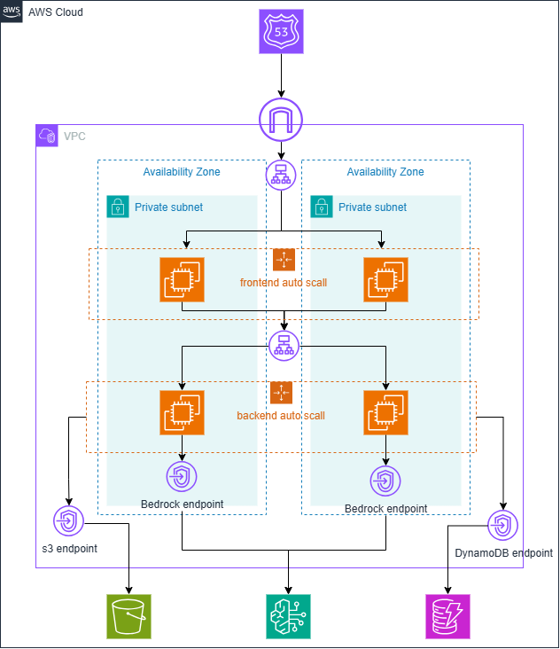

**CV Future Predictor** | [Feature request](.github/ISSUE_TEMPLATE/feature_request.md) | [Bug report](.github/ISSUE_TEMPLATE/bug_report.md) | [General question](.github/ISSUE_TEMPLATE/general_question.md)

> **Status:** the front end and back end are built and run locally in mock mode. The Terraform modules are still placeholders, so nothing is deployed to AWS yet.

## Table of contents

- [Solution overview](#solution-overview)
- [Architecture diagram](#architecture-diagram)
- [Repository layout](#repository-layout)
- [Getting started](#getting-started)
- [Cost](#cost)
- [License](#license)

# Solution overview

Users upload a CV, and an AI model predicts how it could look five years from now.
This is a learning project on AWS: a web tier and an app tier on EC2, files in S3,
results in DynamoDB and predictions from Amazon Bedrock (Amazon Nova).

# Architecture diagram



Request path: user, internet-facing ALB, front end, internal ALB, back end.
The browser uploads the CV straight to S3 with a presigned URL.

# Repository layout

```
.github/                 issue and pull request templates
deployment/              build and test scripts
source/
  frontend/              web server (TypeScript)
  backend/               API server (TypeScript)
  data-models/           types shared by both
  infrastructure/        Terraform root and modules
```

# Getting started

## Prerequisites

- Node.js 22 or later
- Terraform 1.6 or later
- AWS CLI with a configured profile

## 0. Try it locally (no AWS needed)

```bash
cd source && npm install && npm run build
# terminal 1: back end with in-memory S3, DynamoDB and a fake model
cd backend && USE_MOCKS=true npm start
# terminal 2: front end on http://localhost:3000
cd frontend && npm start
```

Upload `deployment/sample-cv.txt` (or any CV). To use real AWS, fill in the placeholders in
`source/backend/.env.example` and `source/frontend/.env.example` and set `USE_MOCKS=false`.

## 1. Install and test

```bash
./deployment/run-unit-tests.sh
```

## 2. Build

```bash
./deployment/build-dist.sh
```

## 3. Deploy (after the Terraform modules are written)

```bash
cd source/infrastructure
cp terraform.tfvars.example terraform.tfvars
terraform init
terraform plan
terraform apply
```

Run `terraform destroy` after each practice session.

# Cost

Load balancers, EC2 instances and interface endpoints are billed while they exist.
Check current prices and set an AWS budget alert before deploying.

# License

Apache-2.0. See [LICENSE](./LICENSE).
